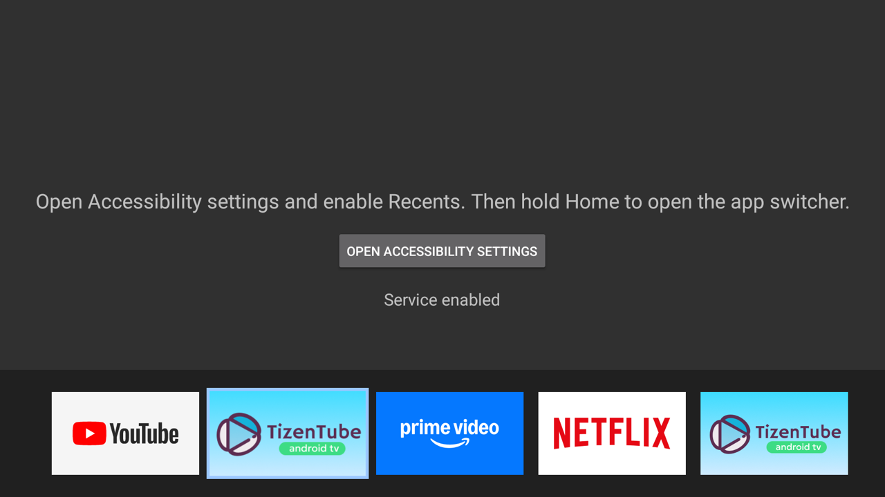

# Recents for Android TV

A phone-style app switcher for Android TV and Google TV. **Hold Home** on the remote, pick a recently used app with the D-pad, and you're back in it. A normal Home tap still goes Home.



Google TV has no recents screen, so switching apps normally means Home, scroll to the apps row, pick the app. Button Mapper's "Recents" action does nothing on it for the same reason: there is no system recents UI to open. This app draws its own.

## How it works

- **Tap Home:** goes Home, as usual.
- **Hold Home (about half a second):** opens a translucent bar at the bottom of the screen with your recently used apps, most recent first (up to 8).
  - Left and right move between apps and wrap around at both ends.
  - OK opens the selected app, back where you left it if the app keeps its state.
  - Back closes the bar. It also closes by itself after 10 seconds without input.
  - If you are inside an app, focus starts on the previous app, so "hold Home, OK" flips between your last two apps.

The hold replaces Google TV's own long-press Home panel (settings, profiles, inputs), which is still reachable from the gear icon on the home screen.

## Install

1. Download the APK from [Releases](https://github.com/rnjnkr/tv-recents/releases) and sideload it, for example `adb install tv-recents-v1.0.0.apk`.
2. On the TV, open **Settings → Accessibility** and turn on **Recents**. The app's own screen has a shortcut for this.

The recents list is stored only on the TV: the app has no internet permission and backups are off.

## Limits

- **"Open apps" is approximated.** Android doesn't let an app list what is running, so the bar shows the apps you used recently, most recent first. An app you closed stays in the list until newer ones push it out.
- **The Home key must reach the app.** It works on a Sony BRAVIA (Android 12). Other accessibility services that grab the Home key, such as Button Mapper, can take it before this app sees it. Turn those off if the hold does nothing.
- **Resuming** depends on the target app keeping its task; some apps cold-start.
- Needs Android 9 (API 28) or newer.

## Build from source

Requires JDK 17+ and the Android SDK (set `sdk.dir` in `local.properties`).

```
./gradlew testDebugUnitTest assembleDebug
```

To make a signed release APK, run `scripts/sign-release.sh`. It builds, creates a keystore on first run in `~/keystores/`, and asks for the password. Back that keystore up.

Debug builds also accept `adb shell am broadcast -a dev.ranjan.tvrecents.DEBUG_HOME --ei ms 700`, which feeds a Home press of that length (in milliseconds) into the app. Keys sent with `adb shell input` skip accessibility services, so this is the only way to drive the hold without the physical remote. It needs the `DUMP` permission, which only adb has, and is inert in release builds.

## License

[MIT](LICENSE)
